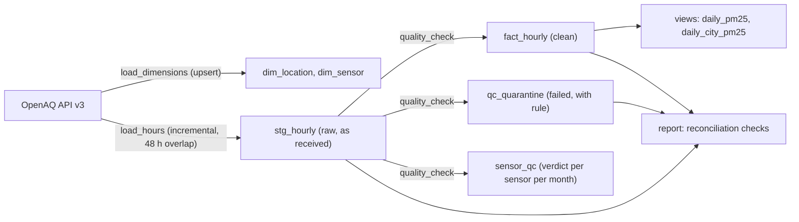

# Air Quality Data Warehouse for Nigeria

A PostgreSQL warehouse of hourly PM2.5 and humidity readings from Nigeria's open air-quality sensor networks. It is loaded incrementally from the OpenAQ API and passes every hour through evidence-based quality rules before anything is averaged. Every number it holds is checked by automated reconciliation.

Nigeria's open air-quality data comes almost entirely from **low-cost sensors run by several different providers**. At the time of writing, none of the active Nigerian locations on OpenAQ was flagged as a reference-grade monitor. These sensors drift, freeze, report zeros, go silent at certain times of day, and sometimes carry wrong metadata. This project builds the pipeline that finds those problems, quarantines them with a recorded reason, and keeps everything else usable.

**At a glance** (from [`results/warehouse_report.md`](results/warehouse_report.md), generated 12 October 2026):

| | |
|---|---|
| Locations / sensors described | 105 / 421 |
| PM2.5 hours staged | 277,160 from 101 sensors (January 2024 to October 2026) |
| Humidity hours staged | 184,099 from 72 sensors (February 2025 to October 2026) |
| Hours quarantined | 34,067 of 461,259 (7.4%), each with the rule that caught it |
| Sensor-months judged | 715: 497 ok, 67 quarantined, 151 unchecked (too few neighbours to judge) |
| Reconciliation checks | 5 of 5 pass |
| Automated tests | 16 pass |

## Architecture



The pipeline is **ELT**: raw hours land in staging exactly as received, and the quality rules run inside the warehouse afterwards. This matters for three reasons:
- some rules need context that arrives across different loads (the hours either side of a spike, other sensors in the same hour);
- thresholds can change and be re-applied to all history without downloading anything again;
- the raw data is never lost.

`python -m pipeline.run_all` runs the four stages in order. It is the single command a daily schedule would call.

## What the data revealed

These findings come from the exploration notebook (a 60-day sample of 16 sensors) and from reviewing the full-data results. They drove the design.

1. **The API's city field was empty for every Nigerian location.** City is therefore derived from coordinates: a location takes the nearest of 13 city centres within 60 km, and is labelled "Other" beyond that. A test pins this behaviour.
2. **Three of six active providers only report at certain times of day.** In the sample, HabitatMap delivered 0% of morning hours (06:00 to 12:00 Nigerian time) but 84% of evening hours. Miri Africa delivered 0 to 25% depending on the block. Morning is also the most polluted block: a median of 27.2 µg/m³, against 19 to 22 at other times. A daily average built from those sensors' hours would understate pollution, so a day only counts if it has at least 18 clean hours **and** at least one hour in every 6-hour block.
3. **A sensor that worked for a year then broke.** Aurassure 16577537 read 0.06 times its Lagos neighbours in the recent sample, but 0.44 times over its whole history. Judging sensors over all their history hid the failure, so sensors are judged **month by month**. It now loses only 4 months, between May and September 2026, and keeps its good history.
4. **All six Miri Africa sensors have bad months, clustered in March to September 2026.** That is 13 sensor-months between them. When every device from one provider fails in the same period, the cause is more likely the provider (calibration, firmware or maintenance) than individual devices. The data cannot say which.
5. **A sensor that reports exactly zero most of the time.** A Clarity sensor at Ogada (Obubra, Cross River State) reported 0.0 µg/m³ for over 14,000 hours. A device that cannot distinguish "no reading" from "clean air" cannot be trusted on its other hours either, so 30 of its months are quarantined. It sits too far from any city for the neighbour check, which is why it needed its own rule.
6. **A school in Cambodia, placed in Nigeria.** The location "AUPP Liger Leadership Academy" is a school in Phnom Penh, but OpenAQ's coordinates (11.89°N, 11.99°E) put it in Yobe State, so it passed the country filter. Its 4,908 hours are quarantined under a documented list of known misplaced locations. Nothing was deleted, and the reason is stored with every hour.
7. **High is not the same as wrong.** One Lagos sensor rose 31 → 150 → 372 → **527** → 231 → 136 µg/m³ over five hours, while four other Lagos sensors stayed between about 20 and 33. That is a real local event, so it is kept. The spike rule therefore flags only isolated one-hour jumps, never values just for being high.
8. **Providers disagree systematically.** HabitatMap sensors read about 0.4 to 0.6 times their neighbours, steadily. This looks like a calibration difference rather than a fault. They pass most months, but sit near the threshold, so a few months are quarantined. Correcting such biases properly needs a reference monitor, and none is reporting.

## Quality rules

Hour rules send failing hours to `qc_quarantine`. Sensor rules judge a whole sensor-month and quarantine all its hours if it fails. Nothing is deleted.

| Rule | Catches | Threshold | Hours caught (sensors) |
|---|---|---|---|
| H1 | Missing value | no value | 435 (13) |
| H2 | Below valid range | PM2.5 ≤ 0; humidity < 0 | 14,889 (25), nearly all from the Ogada sensor |
| H3 | Above valid range | PM2.5 > 1,000; humidity > 100% | 1 (1) |
| H4 | Isolated spike | > 100 **and** > 5× the median of the 2 hours either side | 659 (51) |
| H5 | Stuck sensor (PM2.5 only; humid nights really do sit at 100%) | ≥ 12 identical hours in a row | 7,142 (2) |
| H7 | Unexpected units | not µg/m³ for PM2.5, not % for humidity | 0 |
| H8 | Known misplaced location | documented list, with reason | 4,908 (2) |
| S1 | Sensor-month disagrees with its city | median ratio to same-city neighbours < 1/3 or > 3, over ≥ 50 shared hours with ≥ 3 neighbours | 13,137 (15) |
| S2 | Sensor-month mostly zeros | > 20% of the month's hours exactly 0 | 14,868 (1) |

A sensor-month with too few neighbours to judge is recorded as **unchecked**, never assumed fine. Duplicate hours are made impossible by the primary key, and duplicates sent by the API are counted in the load log (0 so far).

## Results: daily PM2.5 by city

Medians across each city's sensors, on clean data only. The WHO 24-hour guideline is 15 µg/m³.

| City | Days | Sensors per day | Mean of daily medians (µg/m³) | Days above guideline |
|---|---|---|---|---|
| Lagos | 724 | 8.9 | 23.8 | 71% |
| Abuja | 692 | 1.3 | 41.0 | 92% |
| Calabar | 572 | 1.0 | 26.0 | 71% |
| Ibadan | 141 | 4.3 | 29.1 | 97% |
| Enugu | 71 | 1.0 | 14.2 | 45% |
| Port Harcourt | 61 | 2.2 | 21.7 | 75% |

**Read these with care.**
- These are uncorrected low-cost sensor readings, and providers differ in calibration.
- Abuja, Calabar and Enugu rest mostly on a single sensor, so they describe one spot rather than a whole city.
- Cities cover different periods (Ibadan and Port Harcourt only since 2026), so they are not directly comparable.

The table shows how often each place exceeds the guideline, not exact concentrations.

## Reliability

| Property | How | Evidence |
|---|---|---|
| Idempotent | Upserts keyed on natural keys; a primary key on (sensor, hour) | Re-running the dimension loader on unchanged data: 0 new, 0 changed, 101 unchanged |
| Incremental | Per-sensor watermark (last hour stored), fetching only newer hours | Later runs fetch days of data instead of years; the first full load took about 1.5 hours |
| Catches revisions | Re-fetches a 48-hour overlap; changed hours are updated and counted | 5 hours revised by OpenAQ after publication were detected and updated in one run |
| Resumable | One transaction per sensor; a crash keeps finished sensors | A run stopped by an HTTP 408 timeout and another by repeated HTTP 500s both resumed without re-downloading |
| Failure isolation | A failing sensor is logged and skipped; the run is marked failed, and the sensor is retried next run | Sensor 16222985 (AirQo, Ibadan) has returned server errors from OpenAQ on every attempt. 169 other sensors loaded around it. |
| Retries | Backoff of 15, 30, 60 and 120 s on timeouts, server errors and dropped connections; waits for the reset time on HTTP 429 | A 1.1 s pause between calls stays within OpenAQ's 60 requests a minute |
| Observability | `pipeline_run` and `load_log` record every run and every sensor's counts | Run history: 5 failed and 2 succeeded loads, every failure explained |
| Reconciliation | `report.py` runs five checks and exits with an error if any fails | All five pass. On a deliberately corrupted test database, the expected checks failed. |
| Tested | 16 pytest tests cover every rule in both directions (catches the bad, keeps the good) | Changing a threshold on purpose makes the matching test fail |

The five reconciliation checks:
1. Every fetched row is counted as duplicate, new, changed or unchanged.
2. Staging holds exactly the number of rows the loader reported as new. This cross-checks two independent records.
3. Every staged hour is either clean or quarantined, never both and never neither.
4. All clean and quarantined rows come from the latest successful quality check.
5. No run is left in the "running" state.

## Warehouse design

| Table | Holds |
|---|---|
| `dim_location`, `dim_sensor` | What and where: one row per location and per sensor (star schema) |
| `stg_hourly` | Every hour exactly as received; primary key (sensor_id, hour_utc) |
| `fact_hourly` | Hours that passed every rule |
| `qc_quarantine` | Hours that failed, with rule and detail; primary key (sensor_id, hour_utc, rule) |
| `sensor_qc` | One verdict per sensor per month per run: ok, quarantined or unchecked |
| `pipeline_run`, `load_log` | Run history and per-sensor load counts; a CHECK constraint forces the counts to add up |
| `daily_pm25`, `daily_city_pm25` (views) | Daily averages under the day rule, and city medians |

Schema changes are applied as migrations (`sql/03_sensor_qc_by_month.sql`), never by wiping the database.

The quality check rebuilds the clean and quarantine tables from staging on every run (a full refresh, which takes seconds for 460,000 rows). That is the simplest correct choice at this size. At millions of rows it would switch to checking only new hours plus their neighbours.

## Limitations

- **Thresholds were set from evidence, and two rules came from reviewing results.** The first thresholds came from a 60-day sample of 16 sensors. Reviewing the full results then added the month-by-month judgment (S1), the zero rule (S2) and the misplaced-location list (H8), and lowered S1's minimum shared hours from 100 to 50 to suit monthly windows. Each change and its reason is documented above. They have not been validated against an independent reference, because none exists for these sites.
- **No calibration correction.** Without a co-located reference monitor, provider biases (such as HabitatMap reading about half its neighbours) are documented, not corrected.
- **21% of sensor-months are unchecked.** Many cities have fewer than four sensors reporting at once, so the neighbour rule cannot run.
- **City assignment is by distance** to a fixed list of centres. It is a practical approximation, not administrative boundaries.
- **One sensor is missing** (16222985, AirQo, Ibadan) because of persistent OpenAQ server errors.
- **Nigeria only so far.** Adding another country means changing the country code, bounding box and city list in `load_dimensions.py`. The rest of the pipeline is country-agnostic.

## How to run

You need Docker Desktop, Python 3.11 or later, and a free OpenAQ API key (register at [openaq.org](https://openaq.org)).

```bash
cp .env.example .env                     # then put your API key and a database password in .env
docker compose up -d                     # PostgreSQL 16; the sql/ files create the schema on first start
python -m pip install -r requirements.txt
python -m pipeline.run_all               # first run downloads all history, roughly 1 to 1.5 hours (rate limits)
python -m pytest -v                      # 16 tests, about 2 seconds, no database needed
```

Each stage can also be run alone: `python -m pipeline.load_dimensions`, `load_hours` (add `--max-sensors 3` for a quick test), `quality_check` and `report`.

## Repository layout

```
notebooks/01_explore_sources.ipynb   survey of OpenAQ coverage and the fault study behind every rule
pipeline/common.py                   OpenAQ client (retries, backoff, rate limits) and database connection
pipeline/load_dimensions.py          locations and sensors, upserted; city from coordinates
pipeline/load_hours.py               incremental hourly loader with watermarks, overlap and failure isolation
pipeline/quality_check.py            hour rules H1 to H8, sensor-month rules S1 and S2, reconciliation
pipeline/report.py                   reconciliation checks and results/warehouse_report.md
pipeline/run_all.py                  the whole pipeline in one command
sql/01_schema.sql                    tables and constraints
sql/02_views.sql                     daily views
sql/03_sensor_qc_by_month.sql        migration: monthly sensor verdicts
tests/test_rules.py                  16 tests for the rules and city assignment
results/warehouse_report.md          latest report
```

## Data source

Data from [OpenAQ](https://openaq.org) (API v3), which aggregates measurements from many providers (AirGradient, AirQo, HabitatMap, IQAir, Miri Africa, Clarity, Aurassure and others). Each provider's licence and terms apply. This repository does not redistribute the raw measurements, which are downloaded by the pipeline. Your OpenAQ key and database password stay in `.env`, which is git-ignored.
